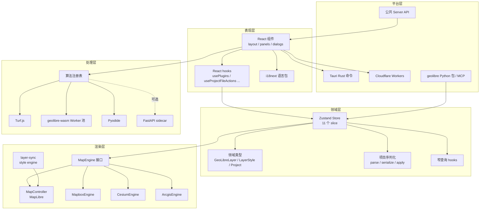
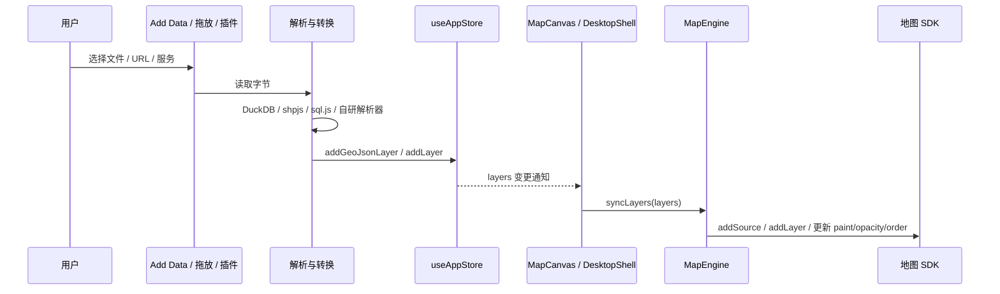
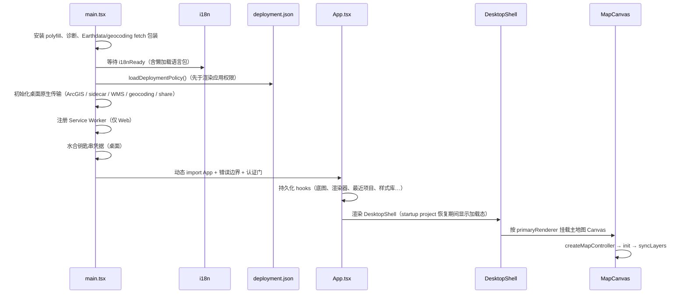

# 02 系统架构

## 1. 分层视图



**依赖方向**：`apps/geolibre-desktop` → `@geolibre/plugins` → `@geolibre/map` → `@geolibre/core`；`@geolibre/processing` 只依赖 `@geolibre/core`；`@geolibre/ui` 与 `@geolibre/embed`、`@geolibre/collab-core` 无内部依赖。详见 [14 依赖关系](14-dependencies.md)。

## 2. 单向数据流

### 2.1 标准链路



关键点：

1. **数据进入**：Add Data 菜单、Tauri 文件对话框、浏览器文件选择器、拖放、`?url=`/`?data=` 深链、插件控件。
2. **转换**：MapLibre 不能直接渲染的本地矢量格式由 DuckDB-WASM Spatial 转为 GeoJSON（`INSTALL spatial; LOAD spatial;` → `ST_Read`）；GeoParquet 走 Parquet reader；压缩 Shapefile 先试 `shpjs`；KMZ 客户端解压；KML 使用自研解析器保留样式，失败回退 DuckDB。
3. **写入**：统一进入 store，生成 `GeoLibreLayer` 记录。
4. **同步**：`MapCanvas`（或 Cesium/ArcGIS/Mapbox 画布）订阅 `layers`，调用 `MapEngine.syncLayers`。MapLibre 的具体实现是 `MapController.syncLayers` → `syncLayer()`（`packages/map/src/layer-sync.ts:481`）。

### 2.2 禁止的写法

| 不要做 | 原因 | 正确做法 |
| --- | --- | --- |
| `map.addLayer(...)`（在面板/插件业务代码中） | 绕过 store，刷新/撤销/项目保存会丢失 | 修改 store 图层状态 |
| `primaryRenderer === "cesium"` 判断功能 | 能力被硬编码，新增引擎即失效 | 查询 `MapEngineCapabilities` |
| 在 UI 中持有 `GeoLibreLayer` 副本并就地修改 | Zustand 依赖引用变化 | `updateLayer(id, patch)` 生成新对象 |
| 跨引擎 import | 一个引擎的改动污染另一个 | 抽到中立模块 |

## 3. Store 的组织方式

`packages/core/src/store.ts` 把 11 个切片组合进一个 Zustand store，并用 `zundo` 的 `temporal` 包裹：

| 切片 | 文件 | 负责的数据 |
| --- | --- | --- |
| `project` | `store/project-slice.ts` | 项目名、路径、脏标记、新建/加载/保存生命周期 |
| `map-view` | `store/map-view-slice.ts` | 相机、底图、地图网格、主/副渲染器、偏好 |
| `layers` | `store/layers-slice.ts` | `layers` 数组与所有图层编辑动作 |
| `layer-groups` | `store/layer-groups-slice.ts` | 图层组树、组可见性/透明度 |
| `project-content` | `store/project-content-slice.ts` | 评论、Dashboard 部件、故事地图、打印布局、书签 |
| `processing` | `store/processing-slice.ts` | 处理模型、运行历史、OBIA 工作台状态 |
| `libraries` | `store/libraries-slice.ts` | 样式库、图层库、模板库 |
| `session` | `store/session-slice.ts` | 选择、识别状态、指针坐标、GPS 读数等临时状态 |
| `collaboration` | `store/collaboration-slice.ts` | 协作会话、参与者、权限、聊天 |
| `capabilities` | `store/capabilities-slice.ts` | 部署权限集合 |
| `ui` | `store/ui-slice.ts` | 所有对话框/面板开关与处理对话框类型 |

`AppState` 是这些切片的交叉类型（`packages/core/src/store/types.ts`）。新增字段时，应加到拥有该数据的切片；跨切片动作通过 `set`/`get` 读写整个 state（例如 `removeLayer` 需要清理其他切片对该图层的引用）。

### 3.1 撤销历史

`store/undo-history.ts` 的 `partializeHistory` 只记录以下字段：

```ts
layers, layerGroups, basemapStyleUrl, basemapVisible, basemapOpacity,
blankBackgroundColor, storymap, comments, widgets, legend
```

相机、选择、`ui` 子状态、SecondaryMapViews、Print Layout 均不进入撤销历史；`finishHistoryStep` 会清理撤销步骤中被删除图层的悬空引用。

### 3.2 窄订阅

每次图层动作都会替换 `layers` 数组，因此 `useAppStore((s) => s.layers)` 会在任何图层编辑时重渲染。为此 `packages/core/src/layer-selectors.ts` 提供：

| Hook | 用途 |
| --- | --- |
| `useLayer(id)` | 订阅单个图层记录 |
| `useLayerIds()` | 只订阅 id 列表 |
| `useLayerSummaries()` | 订阅 `{ id, name, type, visible, groupId }` 行 |
| `useLayersWhen(open)` | 仅在面板打开时订阅完整数组 |
| `NO_LAYERS` | 冻结的空数组常量，避免无意义重渲染 |

## 4. 渲染引擎模型

### 4.1 `MapEngine` 接口

`packages/map/src/map-engine.ts:45` 定义了渲染器中立的操作面，覆盖：

- 生命周期：`destroy()`
- 相机：`applyView`、`easeToView`、`readView`、`flyTo`、`fitBounds`、`fitLayer`、`readProjection`、`applyMapPreferences`
- 图层：`syncLayers`、`waitAndSyncLayers`、`getLayerGeoJson`、`getLayerRasterSource`
- 底图：`setStyle`、`setBasemapVisible/Opacity`、`getBasemapStyleLayerIds`
- 故事地图：`setStoryLayerOpacity`、`restoreLayerStyles`
- 拾取与绘制：`identifyFeatures`、`highlightFeature`、`startManualPlacement`、`drawExtent`、`showSearchResult`
- 控件与地形：`addControl`、`setBuiltInControlVisible/Position`、`setTerrainEnabled`、`setTerrainCogSource`
- 捕获与事件：`getRenderSurface`、`captureImage`、`onMapClick`、`onCameraIdle`、`whenDrawn`
- 逃生舱：`getMap()` 返回底层 MapLibre map（非 MapLibre 引擎返回 `null`）

`init()` 故意不在接口中：构造方式因引擎而异，只由各自的 Canvas 组件调用。

### 4.2 能力标志

`MapEngineCapabilities`（`map-engine.ts:271`）包含：

`styleSpec`、`nativeMapInstance`、`customLayers`、`deckOverlay`、`terrain`、`picking`、`onMapDrawing`、`domControls`、`screenOverlays`、`flatProjection`、`terrainSource`、`ionTerrain`、`nativeZarr`、`nativeDataSources`、`deferredEngineReady`、`measureTool`、`controlLayerPanels`、`supportedLayerKinds`。

`rendererCapabilities(renderer, projection)`（`packages/map/src/renderer-capabilities.ts:24`）在没有活动引擎时按名称给出能力对象，供菜单/插件在挂载前判断。

### 4.3 四引擎对比

| 维度 | MapLibre（默认） | Mapbox | Cesium | ArcGIS |
| --- | --- | --- | --- | --- |
| 类 | `MapController` | `MapboxEngine` | `CesiumEngine` | `ArcgisEngine` |
| 文件 | `map-controller.ts` | `mapbox-engine.ts` | `cesium-engine.ts` | `arcgis-engine.ts` |
| 2D / 3D | 2D（可 globe 投影） | 2D / globe | 3D 地球 | 2D / 3D SceneView |
| Style Spec | 完整 | 完整（Mapbox 扩展） | 无 | 有限（自有渲染） |
| deck.gl 叠层 | 是 | 是（原生宿主） | 否 | 2D 时是 |
| 地形 | DEM / COG | DEM | World Terrain / Ion / COG | 地形服务 |
| 拾取 | 完整 | 完整 | 实体/primitive 拾取 | 服务端 identify |
| 控件 | MapLibre IControl | MapLibre IControl 兼容 | 原生 widget | 原生 widget + 适配 |
| 特色 | 生态最完整、默认 | 与 MapLibre 共享 Style Spec | 3D Tiles、点云、CZML、KML | FeatureServer/MapServer 编辑 |

引擎选择逻辑：

- `primaryRenderer` 决定主地图引擎（`"maplibre" | "mapbox" | "cesium" | "arcgis"`）。
- 每个 `SecondaryMapView.viewKind` 决定分屏窗格引擎。
- `MapGrid`（`apps/geolibre-desktop/src/components/layout/MapGrid.tsx`）布局主窗格 + 副窗格；单窗格时直接渲染主地图。
- 切换引擎会卸载旧 Canvas、挂载新 Canvas，但 store 中的项目状态不变。Cesium 与 ArcGIS 的主画布由 `PrimaryCesiumCanvas` / `PrimaryArcgisCanvas` 挂载。

### 4.4 引擎内部结构

以 MapLibre 为例：

```text
MapCanvas.tsx
  ├─ createMapController() → MapController（实现 MapEngine）
  ├─ identify / popup / selection / photo / raster identify 生命周期
  └─ useAppStore 订阅 → controller.syncLayers(layers)

MapController
  ├─ init()：创建 maplibregl.Map、控件、地形、CRS
  ├─ syncLayers()：diff → syncLayer()
  ├─ applyStoreView / markStoreEcho：避免相机回声抖动
  ├─ 控件宿主 layerControlHost（与 Mapbox 共享）
  └─ 截图 / resize / 事件转发
```

Cesium 侧对应 `CesiumCanvas.tsx` + `CesiumEngine` + `CesiumLayerSync`（`cesium-layer-sync.ts`）；ArcGIS 侧对应 `ArcgisCanvas.tsx` + `ArcgisEngine` + 服务图层构造；Mapbox 侧对应 `MapboxCanvas.tsx` + `MapboxEngine` + `mapbox-layers.ts`。

### 4.5 图层能力矩阵

`classifyLayer()`（`packages/map/src/layer-kind.ts`）把 20 种 `LayerType` 映射为：

- `"native"`：由该引擎自身绘制（例如 MapLibre 的 `geojson`、`raster`、`pmtiles`）
- `"plugin"`：交给插件控件绘制
- `"unsupported"`：该引擎不绘制，UI 标记 "2D only" 或 "3D only"

每个引擎的 `supportedLayerKinds` 表由 `tests/layer-support-matrix.test.ts` 校验一致性。

## 5. 运行时拓扑

### 5.1 形态一：Web

```text
浏览器
  ├─ React 应用（Vite 构建，nginx/静态托管）
  ├─ DuckDB-WASM / PGlite / Pyodide / CereusDB（CDN 或打包）
  ├─ Service Worker（PWA 缓存）
  └─ 可选：/sidecar 反向代理 → FastAPI（Docker 部署）
```

### 5.2 形态二：桌面（Tauri）

```text
Tauri WebView (React)
  ├─ invoke → Rust 命令（文件、钥匙串、原生 HTTP、MBTiles、Martin、Jupyter）
  ├─ 按需启动 sidecar（127.0.0.1:8765，带 per-launch token）
  ├─ 按需启动 Jupyter server（Notebook 面板）
  ├─ 按需启动 Martin tile server（PostGIS 瓦片）
  └─ 本地 DuckDB 可选特性（native-duckdb）
```

### 5.3 形态三：Android / iOS

同一 Tauri 工程，使用 `tauri.android.conf.json` / `tauri.ios.conf.json`。移动端差异：

- `tauri-plugin-geolocation`（打过补丁）驱动原生定位权限。
- Android 文件选择使用 `ACTION_OPEN_DOCUMENT` 并持久化授权（`vendor/tauri-plugin-dialog`）。
- 响应式布局：`useIsMobileViewport`、`COMPACT_LAYOUT_VALUES`。
- iOS/Android 包由 `android.yml` / `ios.yml` 构建。

### 5.4 形态四：Jupyter

```text
Notebook
  └─ anywidget 前端（python/src/geolibre/_frontend.js）
       └─ 内嵌完整 GeoLibre Web 构建（apps/geolibre-desktop/dist-embed）
            └─ 通过 traitlets 同步 .geolibre.json 项目
```

Python `Map` 与 widget 之间通过 `_update_project` / `_add_layer` / 自定义消息同步。JupyterLab 服务器扩展（`geolibre._load_jupyter_server_extension`）负责托管静态资源。

### 5.5 形态五：iframe 嵌入

`@geolibre/embed` 提供无依赖的类型化客户端，通过 `postMessage` 与 `?embed=1` 页面通信；`useEmbedApi` / `useEmbedBridge` 在应用内实现协议。

## 6. 启动时序（前端）



要点：

- **权限先于渲染**：`deployment.json` 的 capabilities 在 App 渲染前应用，避免界面先以全量权限绘制再收回。
- **语言先于渲染**：`i18nReady` 确保第一帧就是正确语言。
- **凭据先于消费**：桌面端 `hydrateDesktopCredentials()` 完成前不渲染，避免读到空 token。
- **认证可选**：仅托管 Web 构建可配置 Clerk/Auth0；桌面与嵌入构建不带门。

## 7. 构建产物与代码分割

`apps/geolibre-desktop/vite.config.ts` 的关键策略：

| 策略 | 说明 |
| --- | --- |
| `CODE_SPLITTING_GROUPS` | 把 Cesium（约 4.7 MB）放入独立 chunk，仅在首次挂载地球时 `import()` |
| `manualChunks` | 每个 `maplibre-gl-*` 插件独立 chunk，按首次使用加载 |
| `bootBundleBudgetPlugin` | 入口静态 JS 图超过 `boot-budget.json` 即构建失败 |
| `GEOLIBRE_NO_EXTERNAL_CDN=1` | 移除所有 GeoLibre 控制的外部 CDN 引用，并禁用依赖它们的功能 |
| `GEOLIBRE_DUCKDB_WASM_CDN=1` | DuckDB-WASM 移到 jsDelivr，满足 Cloudflare 每文件 25 MiB 限制 |
| `GEOLIBRE_EMBED=1` | 生成 Jupyter 嵌入构建，关闭 Service Worker 与 PWA |
| PWA | `vite-plugin-pwa` 生成 Workbox Service Worker（仅 Web 构建） |

详细命令见 [13 构建、运行与测试](13-build-run-test.md)。

## 8. 横切关注点

| 关注点 | 机制 | 入口 |
| --- | --- | --- |
| 国际化 | react-i18next，21 个语言包，RTL 逻辑属性 | `src/i18n/index.ts`、`locales/*.json` |
| 部署权限 | `deployment.json` → `capabilities` slice → `useAppCapability` | `src/lib/deployment-policy.ts`、`src/main.tsx` |
| UI Profile | Beginner/Intermediate/Advanced/Custom，隐藏而非删除 | `src/lib/ui-profile.ts`、`hooks/useUiProfileBootstrap.ts` |
| 凭据 | 桌面钥匙串 / Web localStorage；`secure_store_*` | `src/lib/credential-store.ts`、`src-tauri/src/secure_store.rs` |
| 诊断 | fetch/错误/地图事件采集，Diagnostics 对话框导出 | `src/lib/diagnostics.ts` |
| 错误隔离 | `AppErrorBoundary` + `SectionErrorBoundary` + `SilentErrorBoundary` | `src/components/common/error-boundaries.tsx` |
| 性能 | 窄 store 订阅、虚拟化属性表、懒加载面板/插件、boot 预算 | 各面板与 `vite.config.ts` |
| 离线 | Service Worker 预缓存 + 运行时 CacheFirst | `vite.config.ts` PWA 配置 |

## 9. 架构不变量清单

修改代码前请核对：

- [ ] 新的地图操作是否通过 `MapEngine`，而不是直接依赖 MapLibre？
- [ ] 新的 UI 门控是否读 `capabilities`，而不是引擎名？
- [ ] `packages/map/src` 新增文件是否遵守引擎命名/中立模块规则？
- [ ] 新的图层字段是否加入 `GeoLibreLayer`、项目序列化、撤销 partialize、图层选择器？
- [ ] 新用户可见字符串是否走 `t()` 并更新 `en.json`？
- [ ] 新的处理工具是否注册到正确注册表，并声明参数与输出？
- [ ] 新插件是否声明 `engines`、`id` 与生命周期清理？
- [ ] 新增依赖是否触发 `check:shared-deps` / CSP / 版本镜像维护项？

下一章：[03 仓库结构](03-repository-layout.md)。
