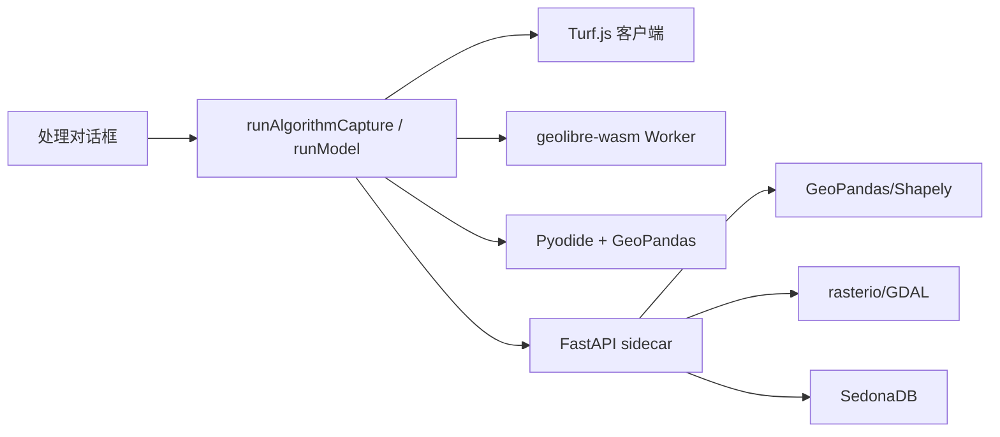

# 06 UI 与地理处理

本章覆盖两个包：

- `@geolibre/ui` —— 共享 UI 原语
- `@geolibre/processing` —— 客户端算法注册表与执行引擎

## 1. `@geolibre/ui`

### 1.1 定位

`packages/ui` 是一个极薄的 shadcn 风格组件库，只负责无业务语义的控件与主题。它不依赖 `@geolibre/core`，可被应用、MCP App 与未来宿主复用。

依赖：Radix UI 原语、`class-variance-authority`、`clsx`、`tailwind-merge`、`lucide-react`、`tw-animate-css`。

### 1.2 组件清单

| 组件 | 文件 | 说明 |
| --- | --- | --- |
| `Button` | `components/button.tsx` | 变体（variant）与尺寸（size） |
| `Input` / `Textarea` | `components/input.tsx`、`textarea.tsx` | 表单输入 |
| `Select` | `components/select.tsx` | 原生/受控选择器 |
| `Label` | `components/label.tsx` | 表单标签 |
| `Slider` / `RangeSlider` | `components/slider.tsx`、`range-slider.tsx` | 单值/区间滑块 |
| `Dialog` | `components/dialog.tsx` | Radix Dialog 封装 |
| `DropdownMenu` | `components/dropdown-menu.tsx` | 完整下拉菜单族（含子菜单、复选框、单选项） |
| `Tooltip` | `components/tooltip.tsx` | 悬停提示 |
| `ScrollArea` | `components/scroll-area.tsx` | 自定义滚动区域 |
| `Separator` | `components/separator.tsx` | 分隔线 |
| `Table` | `components/table.tsx` | 轻量表格 |
| `ColorField` | `components/color-field.tsx` | 颜色选择（含透明色） |
| `ColorRampSelect` | `components/color-ramp-select.tsx` | 色带选择 |
| `ErrorBoundary` | `components/error-boundary.tsx` | 通用错误边界 |
| `DirectionProvider` | 重新导出 `@radix-ui/react-direction` | 支持 RTL |

主题通过 `globals.css` / `theme.css` 暴露 CSS 变量；应用在 `apps/geolibre-desktop/src/index.css` 中组合 Tailwind v4 与这些变量。

### 1.3 使用约定

- 使用 Tailwind 的**逻辑属性**（`ms-`/`me-`/`ps-`/`pe-`/`text-start`/`border-s`/`start-`），不要用 `ml-`/`left-`，否则 RTL 语言会错位。`eslint-rules/no-physical-tailwind.mjs` 会检查。
- 组合类名统一用 `cn()`。
- 新增原语时保持无业务依赖，业务样式留在应用层。

## 2. `@geolibre/processing`

### 2.1 定位

`packages/processing` 定义"算法是什么、参数如何声明、在哪里执行"，不包含对话框 UI。应用层的处理对话框只负责收集参数并调用这里的 runner。

包入口：`packages/processing/src/index.ts`。

### 2.2 算法模型

```ts
interface AlgorithmParameter {
  id: string;
  label: string;
  type: "layer" | "layers" | "number" | "string" | "boolean"
      | "select" | "field" | "path" | "field-weights";
  required?: boolean;
  default?: unknown;
  description?: string;
  options?: ParameterOption[];        // select
  min?: number; max?: number; step?: number;
  geometryFilter?: GeometryFamily[];  // layer pickers
  fieldSource?: string;               // field -> layer param
  visibleWhen?: { param; in[] } | { param; notIn[] };
  fileFilters?: FileFilter[];         // path
}

interface ProcessingAlgorithm {
  id: string;
  name: string;
  description: string;
  parameters: AlgorithmParameter[];
  group?: string;
  supportsSidecar?: boolean;
  requiresSidecar?: boolean;
  run: (ctx: ProcessingContext) => Promise<void> | void;
}

interface ProcessingContext {
  layers: GeoLibreLayer[];
  parameters: Record<string, unknown>;
  log(message: string): void;
  fitBounds?(bounds): void;
  addResultLayer?(name, geojson, options?): void;
  duckdb?: DuckDbCapability;
  viewportBounds?(): Bounds | null;
  signal?: AbortSignal;
}
```

（`packages/processing/src/types.ts:45`、`:122`、`:143`）

`DuckDbCapability` 由宿主注入，工具不直接 import `@duckdb/duckdb-wasm`；这样同一工具可在浏览器、测试与 headless 环境运行。

### 2.3 注册表

| 注册表 | 文件 | 规模 | 示例工具 |
| --- | --- | --- | --- |
| `ALGORITHMS` | `registry.ts` | 2 个基础算法 | `calculate-bounds`、`count-features` |
| `VECTOR_TOOLS` | `vector-tool-registry.ts` | 37 个（含拓扑） | buffer、centroids、convex-hull、dissolve、clip、intersect、difference、union、spatial-join、attribute-join、select-by-value、select-by-location、random-extract、reproject、explode、aggregate、smooth、vertices、points-along、grid、voronoi、sector、polyline 编解码、DGGS 网格/分箱/压缩、轨迹速度、停留检测、时空邻近、图层合并、拓扑检查/修复 |
| `RASTER_TOOLS` | `raster-tools.ts` | 16 个 | hillshade、slope、aspect、reproject、resample、clip-extent、clip-mask、polygonize、contour、interpolate、zonal、raster-calc、spectral-index、reclassify、mosaic、focal |
| `STATISTICS_TOOLS` | `statistics-tools.ts` | 7 个 | Global Moran's I、Local Moran's I、Getis-Ord Gi*、平均最近邻、核密度、新兴热点、综合评分 |
| `NETWORK_TOOLS` | `network-tools.ts` | 3 个 | 等时圈（isochrone）、OD 成本矩阵、顺序路径 |
| `TOPOLOGY_TOOLS` | `topology-tools.ts` | 4 个 | 有效性检查、几何修复、拓扑规则检查、拓扑修复 |
| `DGGS_TOOLS` | `dggs-tools.ts` | 3 个 | 网格生成、点分箱、压缩（按 `dggsType` 分派 H3/S2/A5/DGGRID/DGGAL） |
| `SPECTRAL_INDICES` | `spectral-indices.ts` | 传感器与指数目录 | NDVI、NDWI、EVI 等 |

DGGS 网格另有多套专用构造器（`h3-tools.ts`、`s2-tools.ts`、`a5-tools.ts`、`dggrid-tools.ts`、`dggal-tools.ts`），大多生成 DuckDB SQL 与 GeoJSON。

除上述注册表，处理包还包含：

| 文件 | 能力 |
| --- | --- |
| `antimeridian.ts` | 反子午线几何展开 |
| `raster-client.ts` / `raster-subset.ts` | 栅格读取与子集 |
| `cog-convert.ts` / `wasm-convert.ts` | COG/格式转换 |
| `pmtiles-extract.ts` | PMTiles 抽取 |
| `spectral-indices.ts` | 光谱指数与传感器预设 |
| `terrain-viewshed.ts` + worker | 视域分析 |
| `line-of-sight.ts` | 视线分析 |
| `obia*.ts` + worker | 对象分割（SLIC/Felzenszwalb）、层级、规则集 |
| `object-detection.ts` / `ort.ts` | ONNX Runtime Web 推理 |
| `segment-everything.ts` | SAM 分割 |
| `model-graph.ts` / `runner.ts` | 模型构建器（DAG） |
| `sidecar-client.ts` | sidecar HTTP 客户端 |
| `wasm-capabilities.ts` / `wasm-config.ts` | WASM 能力探测与配置 |
| `wasm-tool-runner.ts` + worker | Whitebox 工具 Worker 池 |
| `wasm-algorithm-audit.ts` | 算法可并行性分类（咨询性） |

### 2.4 执行引擎

一个处理工具可能在四个位置执行：



#### 2.4.1 客户端 Turf.js

矢量工具默认在浏览器主线程或 Worker 中运行，按子包导入（`@turf/buffer`、`@turf/intersect` 等），避免整包体积。

#### 2.4.2 Python sidecar（GeoPandas）

`supportsSidecar` 的工具可选 `vector` extra：sidecar 的 `/vector` 端点用 GeoPandas/Shapely 计算投影感知结果。对话框先请求 `/vector/status`，不可用则回退客户端引擎。

#### 2.4.3 Python（Pyodide）

同一份 `backend/geolibre_server/geolibre_server/vector_ops.py` 通过 Vite 插件 `vite-plugins/copy-vector-ops.ts` 复制进前端；经典 Worker `public/pyodide/pyodide-worker.js` 加载 Pyodide、安装 geopandas，并通过 JSON 字符串调用 `run_vector_tool`。因此 Sidecar 与 Pyodide 结果一致。

#### 2.4.4 Whitebox WebAssembly

`geolibre-wasm`（Rust → `wasm32-wasip1`，约 24 MB）在 `wasm-tool.worker.ts` 中通过 `@bjorn3/browser_wasi_shim` 执行，使用内存虚拟文件系统 `/work`。

`wasm-tool-runner.ts` 维护自适应 Worker 池：

```ts
runWasmToolInBackground(...)   // wasm-tool-runner.ts:423
runParallelWasmTools(...)      // wasm-tool-runner.ts:446
getWasmToolWorkerPoolStats()
releaseIdleWasmToolWorkers()
terminateAllWasmToolWorkers(reason)
```

- `WASM_TOOL_WORKER_IDLE_MS = 30_000`：空闲 Worker 保留 30 秒，避免重复编译约 24 MB 的 WASM。
- `REUSED_WORKER_ACK_MS = 10_000`：复用的 Worker 若 10 秒未确认，视为死亡并替换。
- 每个并发运行默认独占一个 Worker；`executionMode: "threaded-simd"` 时上限为解析出的线程数（1–16）。

`wasm-capabilities.ts` 在**不触发运行时异常**的前提下探测：

1. SIMD128：验证含 `v128.const` 的最小 43 字节模块。
2. 共享内存：验证 `memory 1 2 shared` 模块。
3. 隔离：`globalThis.crossOriginIsolated === true`、`SharedArrayBuffer` 存在、`hardwareConcurrency` 限制在 1–16。
4. `resolveExecutionMode()`（`wasm-capabilities.ts:163`）返回：

| 模式 | 条件 | 并发 |
| --- | --- | --- |
| `threaded-simd` | SIMD + COOP/COEP + SharedArrayBuffer + WASM shared memory | 每并发一个 Worker，上限 1–16（仅在显式请求时） |
| `simd-single-thread` | 仅 SIMD | 每并发一个 Worker，保活 1 个 |
| `portable-single-thread` | 基础 WASM | 每并发一个 Worker，保活 1 个 |

诊断：

```ts
import { getWasmDiagnostics, setWasmRuntimeConfig } from "@geolibre/processing";

const diag = getWasmDiagnostics();
// { activeMode, activeThreads, fallbackReason, ... }
```

跨源隔离需要服务端发送 COOP/COEP。开发服务器通过 `VITE_CROSS_ORIGIN_ISOLATION=1` 开启；生产 nginx 默认不发送，需手动添加：

```nginx
add_header Cross-Origin-Opener-Policy "same-origin" always;
add_header Cross-Origin-Embedder-Policy "require-corp" always;
```

开启后所有跨源瓦片/字体必须支持 CORS 或 `Cross-Origin-Resource-Policy`。

`wasm-algorithm-audit.ts` 把工具按数据依赖分类（`tileable-stencil`、`pixel-independent`、`topological-dag`、`priority-queue`、`radial-raymarch`、`vector-batch`），仅作咨询，runner 不消费，目前没有工具拆分到多 Worker。

### 2.5 Runner

`runner.ts`：

| 函数 | 用途 |
| --- | --- |
| `runAlgorithmCapture(ctx, algorithm, host)` | 运行单个算法，捕获日志与结果，供 UI 展示 |
| `runModel(options)` | 按 `ProcessingModel` 的 DAG 顺序执行多步模型，把中间结果传给下游 |

模型（Model Builder）的定义在 `@geolibre/core` 的 `ProcessingModel` / `ProcessingModelGraph` 类型中；`model-graph.ts` 负责拓扑排序、参数校验与环检测。

### 2.6 矢量 Worker

`vector-tool-runner.ts`：

```ts
runAlgorithmInBackground(toolId, params, host)
canRunVectorToolOnWorker(toolId)
disposeVectorToolWorker()
WORKER_VECTOR_TOOL_IDS
VECTOR_TOOL_WORKER_IDLE_MS
```

只有纯计算、无 DOM/SDK 依赖的工具可放 Worker；其余留在主线程。

### 2.7 Sidecar 客户端

`sidecar-client.ts` 封装：

- 基址解析（桌面 `http://127.0.0.1:8765`；Docker `/sidecar`）
- token 头（桌面 per-launch token）
- 超时、取消、错误规范化
- 能力探测（`/conversion/status`、`/vector/status`、`/sql/status` 等）

### 2.8 大模型与 OBIA

| 模块 | 说明 |
| --- | --- |
| `object-detection.ts` | YOLO ONNX 推理，模型权重默认从 jsDelivr 获取；`GEOLIBRE_NO_EXTERNAL_CDN=1` 时禁用 |
| `segment-everything.ts` | SAM 分割，经 sidecar `/ml/segment` 代理到 `samgeo-api` |
| `obia-felzenszwalb.ts` + worker | 影像分割 |
| `obia-hierarchy.ts` | 对象层级合并 |
| `obia-ruleset.ts` | 规则分类 |
| `obia.ts` | 工作台入口 |

### 2.9 统计与网络

- `globalMoransITool` / `localMoransITool` / `getisOrdTool`：空间自相关，输出统计表与图层。
- `averageNearestNeighborTool`、`kernelDensityTool`、`emergingHotSpotTool`。
- `compositeScoreTool`：多字段归一化（min-max / z-score / rank / quantile）后加权求和。
- `NETWORK_TOOLS`：连通性、成本距离、路径，依赖宿主提供的网络数据源或 OSM。

## 3. 处理对话框与应用层连接

处理 UI 位于 `apps/geolibre-desktop/src/components/processing` 与 `components/layout/desktopShellLazyPanels.ts`：

| 对话框 | 使用引擎 |
| --- | --- |
| `ProcessingDialog` | 通用算法浏览器 |
| `VectorToolsDialog` | Turf / Sidecar / Pyodide 三选一 |
| `RasterToolsDialog` | Sidecar（含客户端回退） |
| `StatisticsToolsDialog` | 客户端统计 |
| `NetworkToolsDialog` | 客户端/网络服务 |
| `ConversionDialog` | DuckDB-WASM / Sidecar / GDAL |
| `BatchToolsDialog` | 批处理 |
| `ModelBuilderPanel` | DAG 模型编辑与运行 |
| `ObjectDetectionDialog` / `SegmentationDialog` / `SegmentEverythingPanel` | ONNX / SAM |
| `ProcessingHistoryDialog` | 运行历史 |

这些面板由 `useAppStore` 的 `ui` 切片打开，参数通过 `runAlgorithmCapture` 交给 `@geolibre/processing`，结果通过 `ctx.addResultLayer` 回到 store。

## 4. 新增处理工具的步骤

1. 在 `packages/processing/src/<area>-tools.ts` 定义 `ProcessingAlgorithm`。
2. 声明 `parameters`（类型、默认值、可见条件、字段来源）。
3. 实现 `run(ctx)`：从 `ctx.parameters` 读取、调用 `ctx.log`、用 `ctx.addResultLayer` 返回结果。
4. 注册到对应数组并导出；必要时加入 `index.ts`。
5. 如果可以在 Worker 运行，加入 `WORKER_VECTOR_TOOL_IDS` 并确认无 DOM 依赖。
6. 如果需要 sidecar，标记 `supportsSidecar` / `requiresSidecar`，并在 `backend/geolibre_server` 增加对应端点。
7. 更新 `docs/user-guide/processing.md` 与 i18n 目录（`npm run i18n:tools`）。
8. 添加 `tests/*.test.ts`。

下一章：[07 插件体系](07-plugins.md)。
