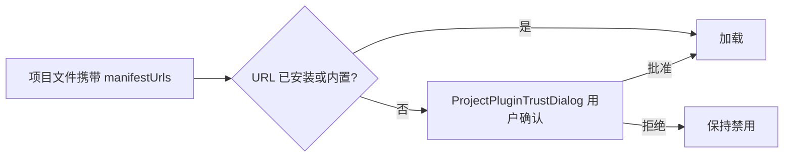

# 07 插件体系 `@geolibre/plugins`

GeoLibre 的插件系统让第三方能力以两种方式进入应用：

1. **内置插件**：随构建打包，源码在 `packages/plugins/src/plugins/`，在 `apps/geolibre-desktop/src/hooks/usePlugins.ts` 注册。
2. **外部插件**：运行时从 zip、`plugin.json` 清单 URL、目录或插件市场安装；部署方可把 drop-in 插件放入 `apps/geolibre-desktop/public/plugins/<id>/` 随构建烘焙。

插件通过受控的 `GeoLibreAppAPI` 与宿主交互，不直接访问 React 树、Zustand store 或 Tauri 命令。

## 1. 插件契约

### 1.1 `GeoLibrePlugin`

`packages/plugins/src/types.ts:1762`：

```ts
interface GeoLibrePlugin {
  id: string;
  name: string;
  version: string;
  activeByDefault?: boolean;
  engines?: MapRendererKind[];        // 默认 ["maplibre"]
  exclusiveGroup?: string;            // 同组插件互斥
  assistant?: { description: string };
  urlParameterNames?: string[];

  activate(app: GeoLibreAppAPI): boolean | void | Promise<boolean | void>;
  deactivate(app: GeoLibreAppAPI): void;

  handleUrlParameters?(app, params: URLSearchParams): void | Promise<void>;
  getMapControlPosition?(): GeoLibreMapControlPosition;
  setMapControlPosition?(app, position): boolean | void;
  getProjectState?(): unknown;
  applyProjectState?(app, state: unknown): boolean | void;

  restoresPanelCollapseState?: boolean;
  clearsStateOnProjectLoad?: boolean;
  sessionScoped?: boolean;
}
```

关键语义：

| 字段/方法 | 说明 |
| --- | --- |
| `engines` | 支持的渲染器；不匹配时插件不会被激活，切换引擎时会被停用/延迟恢复 |
| `exclusiveGroup` | 同组只能激活一个（如 Swipe 与某些分屏插件） |
| `activeByDefault` | 未被项目状态覆盖时的默认激活；外部插件不可强制默认激活 |
| `activate` | 返回 `false`（或 resolve `false`）表示拒绝激活，宿主回滚乐观状态 |
| `deactivate` | 必须清理控件、事件、面板与注册表条目 |
| `getProjectState` / `applyProjectState` | 插件自身状态随项目保存/恢复 |
| `sessionScoped` | 工作区工具（如 S3 Browser），不属于项目，切换项目/地图时保持运行 |
| `clearsStateOnProjectLoad` | 项目数据型插件，每次打开项目都调用 `applyProjectState(undefined)` 清空旧状态 |
| `restoresPanelCollapseState` | 插件自己保存面板折叠状态，项目恢复时宿主不强制折叠 |

### 1.2 `GeoLibreAppAPI`

宿主通过 `createAppAPI()`（`apps/geolibre-desktop/src/lib/app-api.ts:258`）构造 API。它是**按插件作用域裁剪**的：`PluginManager.scopeAppToPlugin` 包装每个成员，使：

- 只有调用者插件激活且引擎匹配时，控件/URL 参数/菜单注册才生效。
- 插件停用后，其异步回调自动失效（generation 代际检查）。
- 插件注册的 Assistant 工具、菜单贡献在停用/失败时自动回收。

API 能力分组：

| 分组 | 成员（节选） |
| --- | --- |
| 图层 | `addGeoJsonLayer`、`updateGeoJsonLayer`、`removeLayer`、`listLayers`、`getLayers`、`getLayerFeatures`、`setLayerVisibility`、`importLayerStyle`、`addTileLayer`、`addWmtsLayer`、`addVectorTileLayer`、`addWmsLayer`、`addWfsLayer`、`addCogLayer`、`addZarrLayer`、`addLayerGroup`、`moveLayersToGroup`、`removeLayerGroup` |
| 栅格/Zarr | `readRasterWindow`、`setCogRenderEngine`、`setZarrLayerSelector`、`queryZarrLayer`、`registerTemporalLayer` |
| 选择 | `getSelectedFeatures`、`getSelectedLayerId`、`getDrawnFeatures`、`onSelectionChange`、`startEditSession`、`getEditSessionLayerId`、`onEditSessionChange` |
| 底图/图层组 | `setBasemap`、`getActiveBasemap`、`getBasemapLayerIds`、`onBasemapChange`、`onLayersChanged` |
| 地图 | `fitBounds`、`getViewBounds`、`getMap`、`getMapRenderer`、`getMapCrs`、`onMapCrsChange`、`getArcgisView`、`getArcgisControlMap`、`getCesiumControlMap`、`getCesiumScene`、`getMapboxMap`、`getMapboxGl`、`getMapboxAccessToken`、`setMapProjection`、`getMapProjection` |
| 控件 | `addMapControl`、`removeMapControl`、`openControlPanel`、`closeControlPanel`、`isControlPanelVisible`、`setBuiltInMapControlVisible`、`get/setBuiltInMapControlPosition` |
| 右侧面板 | `registerRightPanel`、`unregisterRightPanel`、`openRightPanel`、`collapseRightPanel`、`closeRightPanel`、`getActiveRightPanel`、`setActiveRightPanelDock`、`getActiveRightPanelDock` |
| 菜单/浮窗 | `registerToolbarMenu`、`registerMenuContribution`、`registerFloatingPanel`、`openFloatingPanel`、`closeFloatingPanel`、`getOpenFloatingPanels` |
| 数据 I/O | `fetchArrayBuffer`、`nativeFetch`、`downloadRemoteFile`、`pickDownloadFolder`、`readLocalVectorFile`、`pickVectorFilesWithSidecars`、`exportTextFile`、`importTextFile`、`openProjectFromUrl`、`resolvePluginAssetUrl` |
| 外部图层 | `registerExternalNativeLayer`、`unregisterExternalNativeLayer` |
| 地形 | `setTerrainEnabled`、`isTerrainEnabled` |
| 渲染库 | `getDeckGL`、`getMaplibreGlRaster` |
| i18n | `getLocale`、`onLocaleChange`、`translate`、`registerTranslations` |
| 凭据 | `credentials.get/set/location` |
| OAuth | `getOAuthRedirectUri`、`authorizeInPopup` |
| 助手 | `registerAssistantTool`、`registerAssistantToolSpec`、`registerAssistantGuidance` |
| 插件 | `activatePlugin`、`deactivatePlugin` |
| URL | `setUrlParameters` |

> API 中的地图方法都惰性读取当前引擎；未挂载时返回 `null`/`false`/默认值，因此插件可以在 `activate` 时安全注册回调。

### 1.3 渲染器共享库

`getDeckGL()` 返回宿主自己的 `@deck.gl/*` 模块，避免插件打包第二份 deck.gl；`getMaplibreGlRaster()` 同理。插件应优先使用这些共享实例。

## 2. `PluginManager`

文件 `packages/plugins/src/plugin-manager.ts:29`。核心职责：

| 方法 | 说明 |
| --- | --- |
| `register(plugin)` / `registerAll(plugins)` | 注册，检查 id 唯一、保留内置 id |
| `unregister(id, app)` | 停用并移除 |
| `list()` / `isActive(id)` / `getVersion()` | 状态查询 |
| `activate(id, app)` | 激活；处理互斥组、代际、异步回滚 |
| `deactivate(id, app)` | 停用并清理注册 |
| `restoreProjectState(state, app, options)` | 按项目保存的 `activePluginIds` 恢复 |
| `getProjectState()` | 导出项目插件状态 |
| `getMapControlPosition(id)` / `setMapControlPosition(...)` | 控件位置 |
| `subscribe(listener)` | UI 订阅状态变化 |

### 2.1 激活流程

```text
activate(id)
  ├─ 校验：存在、引擎匹配、未在激活中
  ├─ 若已激活 → true
  ├─ deactivateExclusiveSiblings()（互斥组）
  ├─ 递增 generation，scopeAppToPlugin()
  ├─ plugin.activate(scopedApp)
  │    ├─ 抛错 / 返回 false → 清理 URL 参数、回收注册、恢复被顶掉的插件
  │    └─ 成功 → active.add(id)
  ├─ 若返回 Promise → watchAsyncActivation()
  │    └─ resolve false / reject → rollbackFailedActivation()
  └─ notify()
```

要点：

- **乐观状态 + 回滚**：先标记 active，异步挂载失败再撤销，避免菜单显示一个实际未挂载的插件。
- **代际隔离**：`activationGenerations` 防止旧 Promise 回滚新一次激活。
- **失败清理**：`releaseOwnedRegistrations` 回收 Assistant 工具与菜单贡献，`clearUrlParameters` 清除该插件写入的地址栏参数。

### 2.2 项目恢复

`restoreProjectState`（`plugin-manager.ts:630`）：

1. 若渲染器变化或 `mapReplaced`，先停用所有活跃插件（`sessionScoped` 且引擎匹配的除外）。
2. 读取 `activePluginIds`；未列出的用 `defaultActive`。
3. 引擎不支持的 id 放入 `deferredActive`，等引擎切换后再恢复。
4. 同互斥组只保留最后一个。
5. 恢复时折叠新加的控件/右侧面板，避免加载项目时把所有面板展开（`restoresPanelCollapseState` 例外）。
6. 每轮恢复递增 `restorePass`，使旧的异步回调用失效。

### 2.3 插件状态持久化

`ProjectPluginState`（`packages/core/src/types.ts:1874`）：

```json
{
  "manifestUrls": ["https://example.com/plugins/example/plugin.json"],
  "activePluginIds": ["maplibre-layer-control"],
  "mapControlPositions": { "maplibre-layer-control": "top-right" },
  "settings": { "maplibre-gl-swipe": { "orientation": "vertical", "position": 50 } }
}
```

`getProjectState()` 收集每个插件的 `getProjectState()` 结果到 `settings`，保存进 `.geolibre`。恢复时通过 `applyProjectState` 下发。

## 3. UI 贡献面

插件除地图控件外，还可以注册：

| 注册表 | 文件 | 作用 |
| --- | --- | --- |
| 右侧面板 | `right-panel-registry.ts` | 与 Layers/Style 并列的 dock 面板 |
| 工具栏菜单 | `toolbar-menu-registry.ts` | 工具栏下拉菜单 |
| 菜单贡献 | `menu-contribution-registry.ts` | 主菜单项/子菜单 |
| 浮窗 | `floating-panel-registry.ts` | 可拖动浮窗 |
| 控件面板 | `control-panels.ts` | 地图控件的展开/收起状态 |
| AI 助手工具 | `assistant-tool-registry.ts` | 应用内 AI 助手可调用的工具 |

注册项都带 `ownerPluginId`，插件停用时由 `PluginManager` 自动清理。

## 4. 内置插件目录

内置插件 **70** 个，注册数组位于 `apps/geolibre-desktop/src/hooks/usePlugins.ts:209`。按类别：

### 4.1 基础地图

| 插件 | id / 文件 | 作用 |
| --- | --- | --- |
| 图层控制 | `maplibre-gl-layer-control` | 底图/图层列表、可见性、透明度、排序 |
| 底图控制 | `maplibre-basemap-control` | 切换底图预览 |
| OSM 底图 | `osm-basemap.ts` | OpenStreetMap 底图 |
| CARTO Light | `carto-light.ts` | CARTO 浅色底图 |
| 标注 | `maplibre-gl-annotations` | 文本标注 |
| 尺寸 | `maplibre-gl-dimensions` | 尺寸标注 |
| GeoEditor | `maplibre-gl-geo-editor` | 绘制/编辑几何 |
| 方向 | `maplibre-gl-directions` | 路线规划 |
| 反向地理编码 | reverse-geocode | 点击反向地理编码 |
| Swipe | `maplibre-gl-swipe` | 卷帘对比 |

### 4.2 数据目录与公共服务

| 插件 | 作用 |
| --- | --- |
| STAC Catalogs | STAC API 浏览与加载 |
| Planetary Computer | Microsoft Planetary Computer 数据集 |
| Earth Engine | Google Earth Engine 图层 |
| NASA Earthdata / Earthaccess | NASA 数据产品 |
| USGS DEM / USGS LiDAR / USGS NLDI | USGS 高程、点云、水文网络 |
| National Map / EnviroAtlas / FEMA WMS | 美国联邦数据服务 |
| Vantor / Planet Open Data / Portolan | 商业/开放影像目录 |
| OpenAerialMap | 开放航拍影像 |
| OSM Downloader | 按范围下载 OSM |
| IGN LiDAR HD | 法国 LiDAR |
| ArcGIS Portal / ArcGIS Hub | Esri 门户与 Hub 搜索 |
| Tennessee / US Federal / US State / US Local GIS | 各级 GIS 目录 |
| Socrata / CKAN | 开放数据平台 |
| Source Cooperative / S3 Browser | 云存储数据 |
| Natural Earth | 自然地球底图 |
| HuggingFace / Satellite Embeddings | 模型与嵌入数据集 |
| Fields of the World | 农田边界 |
| Sentinel-2 Explorer | Sentinel-2 影像浏览 |
| Ocean Data Platform / Dynamical | 海洋与气象数据 |
| GeoLens | GeoLens 自托管数据服务 |
| Overture Maps | Overture 数据 |
| Mapillary / Street View | 街景 |

### 4.3 栅格与三维

| 插件 | 作用 |
| --- | --- |
| Raster | 栅格图层控件（COG/GeoTIFF） |
| 3D Tiles | 3D Tiles 图层 |
| LiDAR | 点云加载与样式 |
| Splat | 高斯泼溅 |
| Zarr | Zarr 多维数据 |
| Time Slider | 时间轴（COG/XYZ/WMS/GeoJSON） |
| Timelapse | 时序影像播放 |
| Sentinel-2 Composite | Sentinel-2 合成 |
| Components | 封装 `maplibre-gl-components`（FlatGeobuf/PMTiles/Zarr/LiDAR/Splat） |

### 4.4 可视化与分析

| 插件 | 作用 |
| --- | --- |
| Deck.gl Viz | 散点、图标、弧线、网格、六边形、热力等 deck.gl 图层 |
| Graticule | 经纬网 |
| Sun | 太阳光照模拟 |
| Clouds / Precipitation | 云量/降水叠加 |
| Effects | 大气、星空、光晕 |
| Flight Simulator | 飞行模拟（MapLibre/Mapbox/Cesium） |
| Route Animation | 轨迹动画 |
| God's Eye View | 多源摄像头/船舶/飞机实时图层 |
| Elevation Profile | 高程剖面 |
| GeoAgent | 自然语言地图代理 |
| SamGeo | 影像分割 |
| Point Cloud Annotation | 点云标注 |
| OBIA | 对象分析工作台（应用内面板） |

### 4.5 离散全球网格系统（DGGS）

| 插件 | 网格 |
| --- | --- |
| H3 | Uber H3 |
| S2 | Google S2 |
| A5 | A5 |
| DGGRID | DGGRID |
| DGGAL | DGGAL |
| OLC | Open Location Code |
| Geohash | Geohash |
| Tilecode | Tilecode |
| MGRS | 军用网格参考系统 |

## 5. 外部插件加载与安全

### 5.1 来源

| 来源 | 入口 | 说明 |
| --- | --- | --- |
| 插件市场 | `plugin-registry.ts` / `fetchPluginRegistry` | 远程注册表，展示可安装插件 |
| manifest URL | `external-plugins.ts` | 拉取 `plugin.json` 与资源 |
| zip | `installWebPluginArchive` / Tauri 命令 | 上传 zip，解包并校验 |
| 目录 | `pickLocalDirectoryFiles`（桌面） | 开发模式本地目录 |
| 内置 drop-in | `public/plugins/<id>/` | 部署方随构建烘焙 |

### 5.2 信任链



`plugin-trust.ts` 明确：项目文件是数据，可能来自任何人；其中携带的 JS URL **绝不自动加载**，除非：

- 用户已在设置中显式安装（`trustedManifestUrls`）
- 构建内置（`bundledManifestUrls`）
- 用户在当前会话中通过信任对话框批准

### 5.3 部署策略

`plugin-policy.ts` 对每次安装/加载评估：

| 拒绝原因 | 含义 |
| --- | --- |
| `sideload-disabled` | 部署策略禁止侧载 |
| `blocked` | 插件 id 在黑名单 |
| `blocklisted` | 内容哈希命中恶意插件列表 |
| `not-allowed` | 不在部署白名单 |

此外：

- `plugin-blocklist.ts` 从部署策略/远程加载黑名单。
- `plugin-integrity.ts` 计算 bundle 哈希并 pin，防止替换攻击。
- `plugin-archive-unpack.ts` 限制单资源大小（`MAX_PLUGIN_ASSET_BYTES`）、校验 manifest 形状。
- 加载外部插件前调用 `secure_store_seal`，使插件代码无法读取已保存的 token。
- `plugin-credentials.ts` 为插件提供 `app.credentials`，桌面存 `plugin.<pluginId>.<name>`，Web 存 `geolibre.pluginCredential.<pluginId>.<name>`。

### 5.4 插件凭据与 OAuth

- `credentials.get/set/location` 同步 API；桌面写入钥匙串队列，Web 写 localStorage。
- `authorizeInPopup` 用于插件自己的 OAuth；回调地址由 `getOAuthRedirectUri()` 给出。
- 插件的 URL 参数写入受 `urlParameterNames` 白名单限制；停用后宿主清除其参数。

## 6. 新增内置插件的步骤

1. 在 `packages/plugins/src/plugins/<id>.ts` 实现 `GeoLibrePlugin`。
2. 在 `packages/plugins/src/index.ts` 导出。
3. 在 `apps/geolibre-desktop/src/hooks/usePlugins.ts` 的 `BUILT_IN_PLUGINS` 中注册（顺序决定 Plugins 菜单顺序）。
4. 若需要 id 常量，加到 `plugin-ids.ts` 或 `viewer-plugins.ts`。
5. 若是 viewer 模式可用，加入 `viewer-plugins.ts`。
6. 若插件依赖地图控件，确保 `deactivate` 移除控件、事件、面板注册。
7. 若需要项目状态，实现 `getProjectState` / `applyProjectState` 并声明语义字段。
8. 若支持多引擎，声明 `engines` 并在非 MapLibre 分支使用能力/`getCesiumScene`/`getArcgisControlMap`。
9. 若新增用户可见文案，使用 `pluginI18n` / `app.translate` 并更新语言包。
10. 运行 `npm run plugins:docs` 生成插件参考，并补充测试（`tests/plugin-*.test.ts`、必要时 E2E）。

下一章：[08 应用外壳](08-desktop-app.md)。
