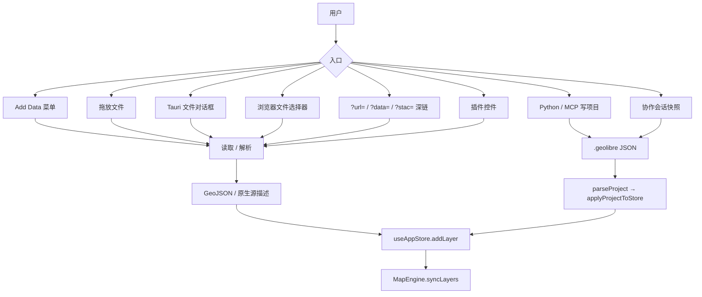

# 12 数据流、格式与持久化

本章把散落在 `lib/`、`packages/core`、`packages/processing` 与 Python 侧的数据处理串成一条完整链路。

## 1. 数据进入的路径



### 1.1 Add Data

`apps/geolibre-desktop/src/components/layout/AddDataDialog.tsx` 是统一入口，按类型分组打开专用对话框：

- 矢量文件（`maplibre-gl-vector` 控件 + 本地解析）
- 栅格（`maplibre-gl-raster` 控件）
- XYZ / WMS / WMTS / WFS / WCS
- GeoJSON URL、矢量瓦片、PMTiles、MBTiles
- ArcGIS FeatureServer / VectorTileServer / MapServer / ImageServer
- 3D Tiles、Cesium Ion、CZML、KML
- Apache Iceberg
- GPX、LandXML、CSV/Excel、Encoded Polyline
- GeoPackage、File Geodatabase（桌面）、OSM PBF
- NetCDF/HDF、Zarr、LiDAR、Splat
- 视频、图片叠加、照片

对话框只收集参数；实际的读取/解析在 `src/lib`，写入统一走 store。

### 1.2 深链

| Query | 加载器 | 说明 |
| --- | --- | --- |
| `?url=<project>` | `useProjectUrlLoader` | 打开远程 `.geolibre` 项目 |
| `?data=<url>` | `useDataUrlLoader` | 加载一个数据 URL 为图层 |
| `?stac=<url>` | `useStacUrlLoader` | 打开 STAC 目录/条目 |
| `?tool=<id>` | `useWhiteboxToolUrl` | 预选处理工具 |
| `?embed=1` / `?layout=viewer` | `useLayoutOptions` | 嵌入/只读布局 |
| `?locale=` / `?lang=` | i18n 初始化 | 语言 |
| `?theme=` | 主题初始化 | 明暗 |

### 1.3 拖放

`hooks/desktop-shell/useFileDrop` 识别：

- 项目文件（`.geolibre` / `.geolibre.json`）
- 矢量文件与压缩包
- 栅格（GeoTIFF/COG）
- LiDAR（LAS/LAZ/COPC）
- 图片（含 EXIF GPS）
- 视频
- GeoPackage
- CSV/Excel

拖放状态由 `useDropStatus` 汇总，错误由 `useUrlLoadErrorNotices` 提示。

## 2. 格式支持矩阵

### 2.1 矢量与表格

| 格式 | 扩展名 | 读取器 | 备注 |
| --- | --- | --- | --- |
| GeoJSON | `.geojson`、`.json` | 原生 `JSON.parse` + 校验 | 支持 Z 值、simplestyle 属性 |
| GeoParquet / Parquet | `.geoparquet`、`.parquet` | DuckDB Parquet reader + Spatial | 读取 geometry 与 CRS；支持坐标列转点 |
| FlatGeobuf | `.fgb`、`.flatgeobuf` | DuckDB `ST_Read` / 专用读取 | 远程 URL 可分块 |
| GeoPackage | `.gpkg` | `sql.js`（读/写）+ `gpkg-reader.ts` | 多图层选择 |
| Shapefile | `.shp` + `.shx/.dbf/.prj`，或 `.zip` | `shpjs` → DuckDB 回退 | `.prj` 提供投影，`.cpg` 提供编码 |
| GML | `.gml` | DuckDB `ST_Read` | 投影处理 |
| MapInfo TAB | `.tab` + 伴随文件 | DuckDB | 需要伴随文件 |
| KML / KMZ | `.kml`、`.kmz` | 自研 KML 解析器 → DuckDB 回退 | 保留样式、图标、ground overlay、model、Super-Overlay；KMZ 客户端解压 |
| GPX | `.gpx` | `gpx.ts` | 航点/轨迹/路线可分图层 |
| LandXML | `.xml`、`.landxml` | `landxml.ts` | TIN、平曲线、纵断面、测量点 |
| CSV/TSV | 分隔文本 | `delimited-text.ts`、`csv.ts` | 坐标列、CRS、或地理编码 |
| Excel | `.xlsx` | `@e965/xlsx` | 选择工作表与坐标列 |
| DXF/DWG | `.dxf`、`.dwg` | `cad-encoding.ts` + 解析 | 图层选择、源 CRS、Z 值 3D |
| File GDB | `.gdb` 目录 | 桌面目录访问 + 读取 | 选择要素类 |
| OSM PBF | `.osm.pbf` | `@osmix/pbf` + `@osmix/core` | Worker 解析 |
| ICESat-2 / GEDI | `.h5` | `h5wasm` | 波束/字段选择、质量控制、范围裁剪、点数上限 |
| Encoded Polyline | 文本 | `packages/core/src/polyline.ts` | 精度 5/6，Google/OSRM/Valhalla/Mapbox |

通用规则：

- 已知源 CRS 会重投影到 EPSG:4326（`datum-shift.ts` / `epsg-proj4.ts` / `geotiff-geokeys-to-proj4`）。
- 多文件格式必须保持伴随文件。
- 超大要素集建议使用 GeoParquet/FlatGeobuf 远程读取或客户端矢量瓦片。

### 2.2 栅格与瓦片

| 格式 | 读取/渲染 |
| --- | --- |
| GeoTIFF / COG | `geotiff` 解码、`cog-tiler-wasm` 分块、deck.gl/GL 渲染；支持远程 Range |
| PMTiles | `pmtiles` 归档 + 自定义协议；矢量/栅格 |
| MBTiles | 桌面 Rust `rusqlite`；浏览器 `sql.js`；自定义协议 |
| Zarr | `zarrita` + `@carbonplan/zarr-layer`；Icechunk 仓库 |
| NetCDF-4 / HDF5 | `netcdfjs` / `h5wasm`；变量与维度选择 |
| COG NetCDF | Kerchunk 引用（`kerchunk-reference-store.ts`） |
| XYZ / WMS / WMTS / WCS | MapLibre source 或专用控件 |
| WFS / OGC API Features | 请求 GeoJSON 或 GML，必要时重投影 |
| ArcGIS | FeatureServer / MapServer / ImageServer / VectorTileServer |
| 视频 | 四角坐标叠加 |
| 图片 | 单图叠加（image overlay） |

### 2.3 三维与点云

| 格式 | 渲染 |
| --- | --- |
| LAS / LAZ | `laz-perf` + `copc` 解码；桌面可读本地文件 |
| COPC | 按视图流式加载八叉树节点（Cesium `cesium-point-cloud-stream.ts`） |
| EPT | `ept.json` 清单 + 按视图流式 |
| 3D Tiles | `3d-tiles-renderer`（MapLibre）或 `Cesium3DTileset` |
| I3S | `@loaders.gl/i3s` / Cesium `I3SDataProvider` |
| glTF / GLB | three.js / deck.gl `ScenegraphLayer` |
| Gaussian Splat | `maplibre-gl-splat` 或 Cesium 原生 `KHR_gaussian_splatting` |
| CZML | Cesium `CzmlDataSource` |
| Cesium Ion | `metadata.sourceKind: "cesium-ion"` |

### 2.4 数据库与 SQL

| 源 | 路径 |
| --- | --- |
| DuckDB / DuckDB Spatial | 浏览器内 DuckDB-WASM；本地文件、远程 Parquet、SQL 查询结果 |
| PostgreSQL / PostGIS | 桌面经 sidecar + Martin 瓦片；也可 PGlite/PostGIS 浏览器内 |
| SQL Server / Azure SQL | sidecar `/mssql`；可编辑图层 |
| Apache Iceberg | DuckDB `iceberg` 扩展；SQL Workspace 专用实例 |
| Apache Sedona | sidecar `/sql` 或浏览器 CereusDB |
| STAC / CSW / CKAN / Socrata | 目录搜索 + 资产加载 |

## 3. DuckDB-WASM 的角色

### 3.1 为什么需要

MapLibre 只能直接渲染 GeoJSON/瓦片。DuckDB Spatial 同时承担：

1. **格式驱动**：`ST_Read` 读取 GDAL 子集支持的矢量格式。
2. **计算引擎**：重投影（`ST_Transform`）、属性查询、空间连接、SQL Workspace。
3. **转换器**：任何输入 → GeoJSON / GeoArrow，再交给 store。

### 3.2 初始化约定

```ts
const spatialExtensionByDb = new WeakMap<duckdb.AsyncDuckDB, Promise<void>>();

export async function ensureSpatialExtension(db, connection, beforeLoad?) {
  let promise = spatialExtensionByDb.get(db);
  if (!promise) promise = (async () => { /* INSTALL spatial; LOAD spatial; */ })();
  spatialExtensionByDb.set(db, promise);
  try {
    await promise;
  } catch (error) {
    if (spatialExtensionByDb.get(db) === promise) spatialExtensionByDb.delete(db);
    throw error;
  }
}
```

三条约定：

- 缓存 **Promise** 而不是布尔值，并发调用共享同一次加载。
- 用 **WeakMap** 按实例缓存，实例重建即失效。
- 失败时只在仍是同一次尝试时清除缓存，避免抹掉别人的新尝试。

### 3.3 Worker 与 bundle

- `duckdb-wasm-bundles.ts` 用 Vite `?url` 显式列出 `mvp`/`eh` 的 wasm 与 worker，保证内容哈希与本地缓存。
- `duckdb-wasm-bundles.cdn.ts` 用于 `npm run lite:build`（jsDelivr，固定版本）。
- `VITE_DUCKDB_SPATIAL_EXTENSION_PATH` 可指定同源扩展路径，跳过 `INSTALL`（离线部署）。
- DuckDB 引擎只在需要时 `import()`，不进入首屏静态图。

### 3.4 SQL 重写

SQL Workspace 对**真实的 reader 参数**做三类重写：

1. 裸 URL/本地路径按扩展名包装为 `read_parquet` / `read_csv_auto` / `ST_Read`。
2. `s3://`、`gs://`、`az://` 转为对应 HTTPS 公共端点。
3. HTTP URL 参数转为 DuckDB 文件句柄，由 JS 侧发 Range 请求。

重写前会做 SQL 字面量/注释掩码，避免误改字符串内容；多语句用 `containsMultipleStatements` 拒绝。

### 3.5 Iceberg

- `lib/iceberg.ts`：持久化配置、SQL 构造、表选择规则（无 DuckDB 依赖）。
- `lib/iceberg-loader.ts`：在 SQL Workspace 的专用 DuckDB 实例上执行（需要 pre-spatial 预热与 `resetSqlDatabase` 恢复）。
- 只接受 DuckDB 报告为原生 `GEOMETRY` 的列；CRS 必须来自 schema，不接受用户覆盖。
- 行数上限、先展示 `count(*)`、不支持自动刷新（`supportsAutoRefresh` 排除）。

## 4. 项目持久化

### 4.1 保存

```text
useProjectFileActions / Tauri save
  → projectFromStore(storeSnapshot)
  → splitProjectCredentials（桌面：凭据移入钥匙串）
  → serializeProjectWithLayerCache
  → .geolibre 文件
```

要点：

- 默认（桌面）先问"保留还是剥离"敏感值；不会未经选择写明文。
- Web 端凭据留在项目文件中（用户可见），但导出/分享/嵌入会脱敏。
- session-only 图层、临时过滤（`timeFilter`/`embedFilter`）不保存。
- 空的 `legend`/`printLayout`/`storymap`/`models`/`comments` 不写，保持旧文件字节形状。

### 4.2 打开

```text
读取文件 / URL / 拖放
  → parseProject(json)（容错 + normalize）
  → applyProjectToStore(project)
  → 恢复相机、底图、图层、组、插件、模型、故事地图…
  → usePlugins.restoreProjectState
  → MapEngine.syncLayers
```

`parseProject` 对每类字段都有 `normalize*`，未知/非法值被丢弃而不是污染 store。

### 4.3 自动保存与恢复

| 机制 | 文件 |
| --- | --- |
| 自动保存状态 | `lib/autosave-status.ts`、`store/project-slice.ts` |
| 崩溃恢复 | `ProjectRecoveryDialog` + 本地快照 |
| 项目历史 | `ProjectHistoryDialog`、`project-diff.ts`、`lib/project-diff.worker.ts` |
| 最近项目 | `useRecentProjectsPersistence` |
| 启动恢复 | `useStartupProject` |

### 4.4 项目文件结构

完整字段见 [`docs/project-format.md`](../project-format.md) 与 [04 核心状态层](04-core-state.md)。要点：

- 顶层 `version`、`name`、`mapView`、`basemap*`、`layers`、`styles`、`preferences`。
- 可选：`layerGroups`、`plugins`、`legend`、`printLayout`、`storymap`、`models`、`processingHistory`、`obia`、`widgets`、`mapLayout`、`secondaryMapViews`、`bookmarks`、`styleLibrary`、`primaryRenderer`、`comments`、`interaction`。
- 图层内的 `style` 也会同步到顶层 `styles`，方便外部工具读取。

## 5. 导出

| 导出 | 入口 | 说明 |
| --- | --- | --- |
| GeoJSON | 图层菜单 / 属性表 | 应用 `fieldVisibility`、过滤隐藏字段 |
| GeoParquet | 转换工具 / 图层菜单 | DuckDB |
| FlatGeobuf | 转换工具 | DuckDB |
| Shapefile | 转换工具 | sidecar（含伴随文件） |
| GeoPackage | 转换工具 / `geopackage-writer.ts` | sql.js |
| PMTiles | 转换工具 | freestiler / sidecar |
| COG | 转换工具 / 地理配准 | rio-cogeo / gdal3.js |
| LAS / LAZ / COPC | 点云图层菜单 | laspy / 客户端 |
| KML | `kml-writer.ts` | 样式与图标 |
| CSV/Excel | 属性表 | `csv.ts` / `xlsx` |
| PNG | 地图截图 / Print Layout | `captureImage` |
| PDF | Print Layout | jsPDF |
| 独立 HTML | `html-export.ts` / MCP `export_html` | 注入项目到托管查看器 |
| 视频 | 录制 | `map-recorder.ts` |
| 数据 URL | 分享/嵌入 | `data-url.ts` |

脱敏：

- `excludeHiddenFieldsFromProject` 删除标记为 excluded 的字段。
- `redactCredentials` 递归移除 URL、请求头、配置中的密钥。
- 分享/嵌入/MCP 导出前都会调用。

## 6. 分享与协作

| 方式 | 机制 |
| --- | --- |
| 分享链接 | 公共 Server API 上传项目，返回 `share.geolibre.app/<user>/<slug>` |
| 匿名公开 | 项目可见性 `public`；查看器只读 |
| Fork | 复制公开项目到自己的账号 |
| 嵌入 | `?embed=1` + `@geolibre/embed`，可传 filters、相机、图层可见性 |
| 协作 | WebSocket 中继，host 上传快照，guest 同步 |
| 导出 HTML | 独立页面，内嵌托管查看器 |
| MCP/Agent | 写 `.geolibre.json` 交给用户打开 |

分享不会上传图层背后的原始数据；项目文件中的内联 GeoJSON 会随项目上传。

## 7. 离线与缓存（PWA）

仅独立 Web 构建注册 Service Worker；桌面与 Jupyter 嵌入不注册。

| 缓存层 | 内容 | 策略 |
| --- | --- | --- |
| Precache | HTML、启动所需 JS/CSS | 首次访问后离线可用 |
| 同源 `/assets/` | MapLibre、DuckDB-WASM、插件 chunk | CacheFirst（文件名带哈希） |
| `geolibre-cdn-engines` | Pyodide、PGlite/PostGIS、CereusDB、gdal3.js | CacheFirst（URL 带版本） |
| 底图 | OpenFreeMap、CARTO 瓦片/样式 | 运行时缓存 |
| 其他远程服务 | WMS/WFS/ArcGIS/自定义瓦片 | 不缓存，离线不可用 |

启用 PGlite 与 CereusDB 离线：

```bash
GEOLIBRE_PGLITE_CDN=0
GEOLIBRE_CEREUS_CDN=0
```

完全移除外部 CDN：

```bash
GEOLIBRE_NO_EXTERNAL_CDN=1
```

它会禁用依赖外部 CDN 的功能（storymap HTML 导出、内置 YOLO 模型、SAM、3D Tiles Draco/KTX2、GDAL 导出），并强制 `PGLITE_CDN=0`、`CEREUS_CDN=0`、`GDAL_CDN=0`、`DUCKDB_WASM_CDN=0`。

DuckDB 例外：默认打包（关键路径），但 Cloudflare Pages 的 25 MiB 单文件限制要求 `GEOLIBRE_DUCKDB_WASM_CDN=1` 或 `npm run lite:build`。

## 8. 数据隐私

- 本地文件默认不上传；浏览器 WASM 处理在本地完成。
- 远程高程查询需用户同意（`elevation-consent.ts`）。
- 地理编码请求受节流与 provider 配置控制。
- 项目分享/嵌入/导出前脱敏凭据。
- 图层请求头使用 `${ENV_VAR}`，不保存真实 token。
- 诊断与遥测默认不带数据内容；分析仅在托管 Web 构建启用。

下一章：[13 构建、运行与测试](13-build-run-test.md)。
